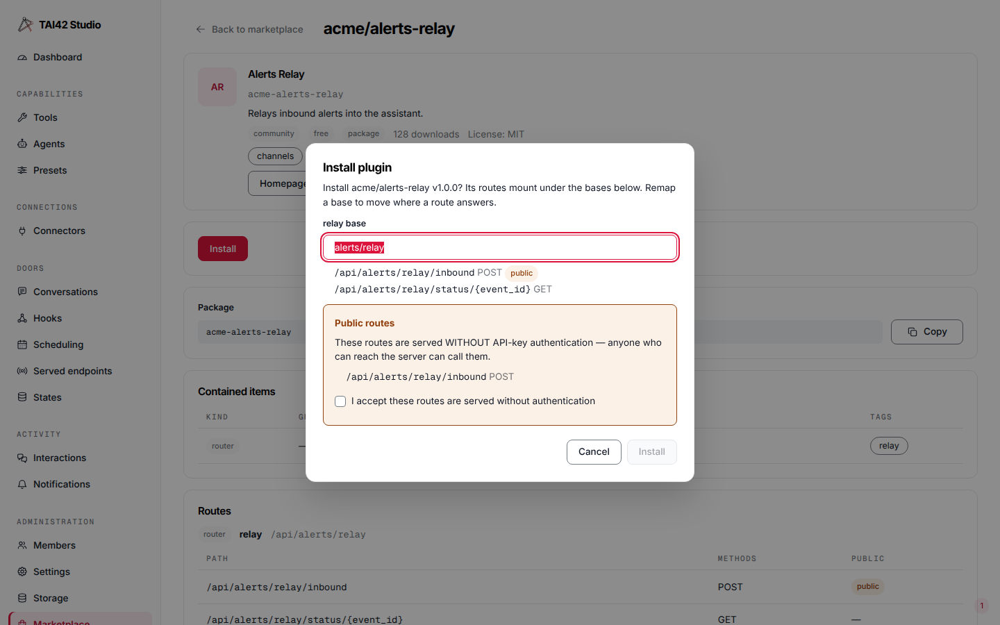
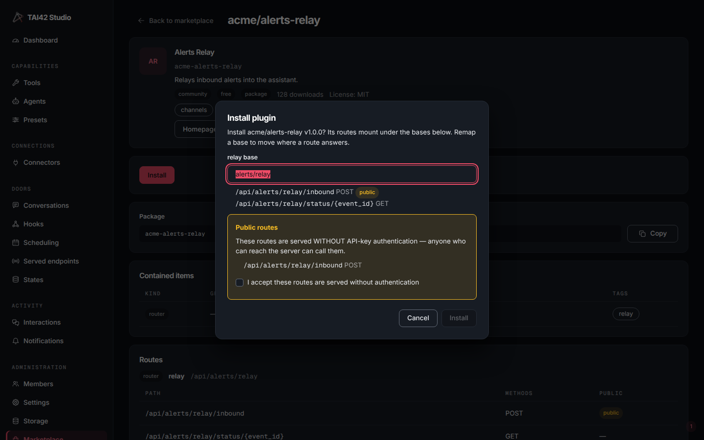

Install a marketplace plugin into a running server in one command. Install is
a server-side operation: the server itself resolves the listing, installs the
package, patches its manifest, and reloads — so the CLI, the Studio, and the
HTTP API all drive the same flow.

<Steps>
  <Step title="Find the plugin ref">
    Every listing is addressed as `namespace/name`. Find it with
    [search](/marketplace/browse) — `tai plugins search uuid` names the listing
    that ships the item you want.
  </Step>
  <Step title="Install">
    <CodeGroup>

    ```bash CLI
    tai plugins install tai42/toolbox
    ```

    ```bash HTTP
    curl -X POST https://<your-server>/api/marketplace/install \
      -H "x-api-key: $TAI_API_KEY" \
      -H "content-type: application/json" \
      -d '{"ref": "tai42/toolbox"}'
    ```

    </CodeGroup>

    Pin a version with `--version` (or a `version` field in the body); with no
    version the server resolves the **newest version compatible with the core it
    is running** — a core-aware pick, so an install never lands a version your
    running core cannot load. A version you pin explicitly is still checked
    against the server's installed tai42-contract — one that does not fit refuses
    to install, and the error names the mismatch.
  </Step>
  <Step title="Verify">
    ```bash
    tai plugins installed
    ```
    The plugin appears with its installed version, and its items are live —
    its tools list under `tai tools`, its extensions under `tai extensions`.
  </Step>
</Steps>

## What install does

1. Resolves the ref against the registry — with no pinned version, the newest
   version compatible with the server's installed tai42-contract (core-aware
   resolution) — and checks advisories. A version that does not fit the
   contract, one that is killed, or one under a non-withdrawn critical advisory
   refuses before anything changes.
2. Builds the resolved version's environment beside the one in use, then
   switches to it. An in-process plugin rebuilds the shared plugin layer with it
   added; an `mcp-server` package builds its own environment. Either build runs
   under the image's constraints and refuses with a `409` when the plugin's
   dependencies conflict with the installed plugins or the image. By source: a
   GitHub-sourced plugin downloads the release tarball, verifies its SHA-256
   against the digest the registry recorded at ingest, keeps that verified file
   under `TAI_PLUGINS_DIR/artifacts`, and installs only it — a re-pointed tag is
   refused; a PyPI-sourced plugin pins the exact version (`package==version`) and
   relies on PyPI's file immutability for that version.
3. Patches the server [manifest](/concepts/manifest) once per provided item — a
   tool module lands under `tools`, an extension module under
   `extensions_modules`, and so on, exactly as the plugin's
   `tai-plugin.yml` declares.
4. Reloads the server, records the marketplace ref and version locally, and
   deletes the builds no longer in use.

If any step fails, the whole install aborts and the error names the step —
never a half-installed plugin. A failure before the switch leaves the environment
in use untouched; a failure after it switches the environment back, and the
manifest, registration, and install record fully revert.

Install, update, uninstall, `tai plugins upgrade --all` and `tai plugins rebuild`
hold one fleet-wide lock, so two never run at once: a second one is refused at once
(over HTTP, a retriable `503`). An install, update or uninstall holds the lock
exclusively while it changes the plugins directory, the install store and the
manifest. When its change restarts workers, it then holds the lock shared for that
restart roll: a restarted worker checks its plugin environments at boot under the
shared lock, so it verifies the finished change and joins the fleet, while a second
operation is still refused until the roll ends.

Registry-dispatched items — tools, agents, extensions, storages, and a channel's
registration and outbound delivery — are live the moment that reload lands, and
so are the HTTP surfaces. A **router** or **middleware** plugin, and a Tier-2
channel's inbound webhook route, come live on the next reload / config-apply: the
[epoch rebuild](/concepts/live-operations#the-mutation-pipeline) re-imports the
plugin package and its route-sibling modules and re-registers the declared routes,
so a route-carrying plugin is serving on the same reload as the rest — no full
process restart required (Tier-1 confirm/external channels register no inbound
route). See
[self-hosted upgrades](/self-hosted/upgrades#runtime-installed-plugins).

<Note>
A packaged install writes the plugins directory (`TAI_PLUGINS_DIR`) and the
manifest, and refuses until `TAI_PLUGINS_DIR` names a writable directory. On a
self-hosted deployment, keep both on persistent storage — the plugins directory
and the manifest file — so a container recreation does not drop the plugin. See
[the persistent mounts](/self-hosted/quickstart#the-persistent-mounts).
</Note>

## Provide required environment

Some plugins need environment values to run — an MCP server's `!ENV` markers, an
OAuth [connector](/concepts/connectors)'s client id and secret. The **server**
decides what a given install requires: the install preview computes the listing's
`required_env` — each variable as `{name, secret}` — and the `missing_env` still
absent from this server's environment. Every surface reads that one server-computed
answer; none of them re-derives it.

- **CLI** — `--env KEY=VALUE` supplies a value, and it is the only flag that
  carries a value. `--secret KEY` is a bare mark (a key, no value) that keeps that
  key masked in the environment and out of logs; a value you want hidden is still
  passed with `--env KEY=VALUE` and additionally marked with `--secret KEY`. A
  connector's client secret is auto-marked, so the mark is optional there. Both
  flags are repeatable.
- **Studio** — the install dialog lists the missing variables, prompts for them,
  and seeds each secret toggle from `required_env`, so you fill exactly what the
  server says is missing.

```bash
tai plugins install acme/connector-example \
  --env ACME_CLIENT_ID=... \
  --env ACME_CLIENT_SECRET=... \
  --secret ACME_CLIENT_SECRET
```

Every value you supply is written to the env store, a key the store already holds
included. A value for a key the deployment itself sets, other than the copy the store
holds, is refused with a `400` naming the key: the deployment's value wins at every
boot and reload, so change it in the deployment's environment and restart (see
[deployment values and stored values](/concepts/config-and-secrets#deployment-values-and-stored-values)). An
install that would leave a required variable unresolved is refused before
anything is written, and the error names the variables. `--dry-run` shows the
delivery and the required env without installing.

## Mount the routes

A plugin that mounts HTTP routes — a `router` item, or a `channel` with an inbound
webhook — [declares](/concepts/marketplace#declared-http-routes) them relative to a
`base` prefix, and install is where you see the resulting absolute paths, remap the
prefix if you want, and accept any route the plugin serves without a credential.

<Frame caption="The Studio install dialog: each route resolved to its full path, a per-item base to remap the prefix, and the acceptance checkbox for the routes served without authentication.">
  
  
</Frame>

**Preview first.** Ask the server what a given install would mount — no side
effects, nothing written:

<CodeGroup>

```bash CLI
tai plugins install acme/alerts-relay --dry-run
```

```bash HTTP
curl -X POST https://<your-server>/api/marketplace/install/preview \
  -H "x-api-key: $TAI_API_KEY" \
  -H "content-type: application/json" \
  -d '{"ref": "acme/alerts-relay"}'
```

</CodeGroup>

The preview resolves each route to its full `/api/...` path, flags which are public,
and lists any collision with a route the core or an already-installed plugin owns.
`--dry-run` prints that table and exits non-zero if anything collides.

**Remap the base.** Every route-carrying item mounts under a default `base`; move it
with `--mount item=base` (repeatable), or a `route_mounts` object in the body. The
whole item's routes shift together — only the `base` moves, never the `/api/` root
or a route's own path:

<CodeGroup>

```bash CLI
tai plugins install acme/alerts-relay --mount relay=alerts/relay-2
```

```bash HTTP
curl -X POST https://<your-server>/api/marketplace/install \
  -H "x-api-key: $TAI_API_KEY" \
  -H "content-type: application/json" \
  -d '{"ref": "acme/alerts-relay", "route_mounts": {"relay": "alerts/relay-2"}}'
```

</CodeGroup>

**Accept the public routes.** A route the plugin declares `public` answers
**without authentication** — an inbound webhook has to. Install refuses until you
say so: without acceptance it returns `400 PUBLIC_ROUTES_NOT_ACCEPTED` and lists the
routes, so opening an unauthenticated door is always a deliberate step. Accept with
`--accept-public-routes` (or `"accept_public_routes": true`). On an **update**, only
a route that is newly public — not one you already approved on the installed
version — needs accepting again.

The install receipt returns the mounted routes — each item, full path, methods, and
public flag — so you can confirm what opened where.

### A collision is a remap

Two plugins can never own the same route. If a plugin's resolved paths clash with a
route the core or another installed plugin already owns, install stops with
`409 ROUTE_COLLISION` and names the clashing paths; nothing is installed. The remedy
is to remap the colliding item onto a free `base` and install again:

```bash
tai plugins install acme/alerts-relay --mount relay=alerts/relay-b
```

The same check runs on the manifest patch, so a collision is caught in pre-flight,
before any package is fetched.

**Mounts persist across restart.** The server stores each item's chosen `base`
alongside the install record, so a reload or a container recreation brings every
route back up at the same path — a remapped route stays remapped, with no re-entry
of the mount. Keep the install record and manifest on
[persistent storage](/self-hosted/quickstart#the-persistent-mounts) so a recreated
container does not lose them.

## Update

```bash
tai plugins update tai42/toolbox
```

`tai plugins installed` shows update availability per plugin; update resolves
the new version and runs the same install flow. Pin a target with `--version`,
or omit it for the latest. An update keeps each MCP entry's `include` / `exclude`
(the tool selection) and replaces every other key of the entry with the new
version's.

To move the whole installed roster onto versions compatible with the running
core in one step — the flow after a [self-hosted image upgrade](/self-hosted/upgrades#runtime-installed-plugins):

```bash
tai plugins upgrade --all
```

## Uninstall

```bash
tai plugins uninstall tai42/toolbox
```

Uninstall works from the local install record alone, with no registry call. For a
packaged plugin it first switches to an environment without the plugin — the
plugin layer rebuilt without it, or, for an `mcp-server` package, its environment
withdrawn. It then strips the plugin's entries from the manifest and reloads the
fleet onto the stripped manifest, deletes the install record, and finally deletes
the builds no longer in use (a server package's whole environment). A failed
reload or record delete switches the environment back and raises; a manifest
change that already landed stays, and re-running uninstall completes the removal.
An unknown ref refuses with `<ref> is not installed`. The receipt's
`manifest_written` says whether the manifest was written.

With `--offline`, uninstall runs on the deployment host with no server, and the
next server start loads the result. It is the way out when a plugin keeps the
server from starting — see
[A plugin that blocks the upgrade](/self-hosted/upgrades#a-plugin-that-blocks-the-upgrade).

```bash
tai plugins uninstall tai42/toolbox --offline
```

<Warning>
  Install, update, and uninstall mutate the running server's environment;
  `tai plugins uninstall --offline` mutates the deployment's stores from the host
  with no server. Scope the `/api/marketplace/*` routes with
  [access control](/concepts/access-control) like any other mutating surface.
</Warning>

## From the Studio

The Marketplace screen's plugin detail offers the same install, update, and
uninstall actions with progress surfaced in place — it drives these routes. Each
result shows the fleet report and the worker recycle report. Installing, updating,
uninstalling and upgrading all need an administrator: any other session sees a line
naming the route in place of the button. The [Connectors](/studio/screens#connectors)
screen installs a listing inside its Connect step.

## See also

- [Browse and search](/marketplace/browse) — find the ref.
- [Advisories](/marketplace/advisories) — what a killed version means.
- [The manifest](/concepts/manifest) — what the patch touches.
